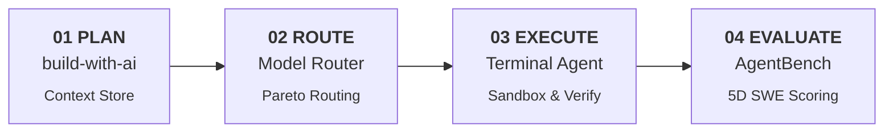

<div align="center">

# Picado Labs

**Deterministic, verify-first developer infrastructure for autonomous AI software engineering.**

[](https://picadolabs.me)
[](https://github.com/PicadoLabs)
[](LICENSE)
[](https://picadolabs.me)

<br/>

> Instead of trusting a monolithic AI prompt, PicadoLabs divides the software engineering lifecycle into four verifiable, specialized open-source systems.

</div>



---

### Core Systems

| Project | The Problem | The Picado Edge | Traction | Contribute |
| :--- | :--- | :--- | :---: | :---: |
| [**build-with-ai**](https://github.com/PicadoLabs/build-with-ai) | AI coding suffers from context drift, blank-canvas paralysis, and broken code. | Zero-API CLI with 11 production templates and persistent `.buildwithai/` context. | **1.2k+** Downloads<br/>**21** Contributors | [Issues](https://github.com/PicadoLabs/build-with-ai/issues) |
| [**AI Model Router**](https://github.com/PicadoLabs/ai-model-router) | Ballooning API costs, provider rate limits, and unpredictable model latency. | Sub-3ms Pareto Traffic Control Room UI with Thompson Sampling RL auto-tuning. | **3.4k+** Downloads<br/>**11** Contributors | [Issues](https://github.com/PicadoLabs/ai-model-router/issues) |
| [**Terminal Agent**](https://github.com/PicadoLabs/terminal-agent) | Autonomous coding agents make unverified changes and break repository builds. | Verify-first sandboxing (Docker/psutil), 12 core tools, self-healing, and rollback. | **700+** Downloads<br/>**3** Contributors | [Issues](https://github.com/PicadoLabs/terminal-agent/issues) |
| [**AgentBench**](https://github.com/PicadoLabs/agent-bench) | Existing benchmarks test isolated toy prompts rather than multi-turn agents on codebases. | 12 polyglot benchmarks, local Ollama mode ($0 cost), and 5D composite scoring. | **12** Benchmarks<br/>**3** Contributors | [Issues](https://github.com/PicadoLabs/agent-bench/issues) |

---

### Install Packages

```bash
# 01 / Plan: build-with-ai - CLI architecture prompt architect
npm install -g build-with-ai

# 02 / Route: AI Model Router - Sub-3ms routing engine & traffic UI
pip install model-router-cli

# 03 / Execute: Terminal Agent - Verify-first autonomous coding agent
pip install terminal-agent-cli

# 04 / Evaluate: AgentBench - Agent evaluation & benchmark suite
pip install agentbench-core
```

---

<div align="center">

### Community

Maintained by **[@Vardhman Gupta](https://github.com/Kaap10)** & the PicadoLabs open-source community.  
**Open source under Apache-2.0.** Contributions, issue reports, and PRs are welcome across all repositories.

[Official Website](https://picadolabs.me) • [GitHub Organization](https://github.com/PicadoLabs) • [X (@PicadoLabs)](https://x.com/PicadoLabs) 

</div>
